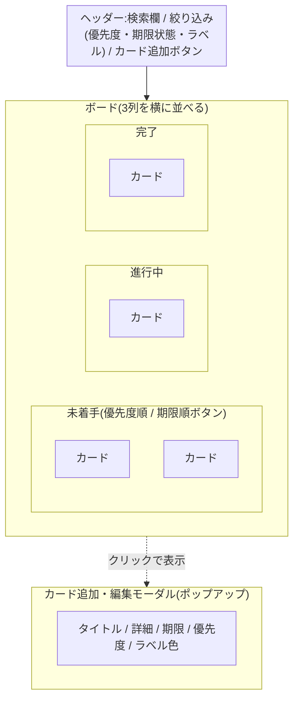
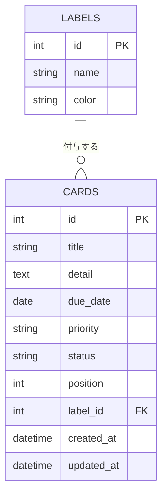
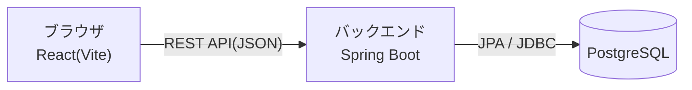

# 基本設計書:タスク管理ボード(仮)

要件定義は [requirements.md](requirements.md) を参照。本書では、要件を実現するための画面構成・データ設計・技術スタックを定義する。

## 1. 画面構成

- 画面は1枚(ボード画面)。
- 「未着手 / 進行中 / 完了」の3列を横に並べる。
- カードの追加・編集はモーダル(ポップアップ)で行う。
- 検索欄・絞り込みはボード上部に置く。
- 各列の見出しに「優先度順」「期限順」の並べ替えボタンを置く(F-15)。

### 1.1 ワイヤーフレーム

## 2. データ項目(カード)

| 項目 | 内容 | 入力 |
|---|---|---|
| タイトル | 文字列 | 必須 |
| 詳細 | 文字列(複数行) | 任意 |
| 期限 | 日付 | 任意 |
| 優先度 | 高 / 中 / 低(初期値は「中」)。色や印で表示する | 必須 |
| ラベル色 | 色の選択肢(F-07 実装時) | 任意 |
| 状態(列) | 未着手 / 進行中 / 完了 | 自動 |
| 並び順 | 列内での表示順(ドラッグ&ドロップ、または並べ替えボタンで変更) | 自動 |

### 2.1 ER図

ラベル色(F-07)を独立したマスタとして切り出し、カードから参照する構成とする。

- CARDS.position は列内の表示順。並べ替えボタン(F-15)は、並べ替えた結果で列内の position を振り直す。表示時に都度ソートするのではなく保存済みの position で表示するため、並べ替え後もドラッグで自由に入れ替えられる。
- CARDS.status は「未着手 / 進行中 / 完了」を表す(列の追加はしないため固定値とし、別テーブルには分けない)。
- 利用者は自分ひとりのためユーザーテーブルは持たない。

## 3. 技術スタック

フロントエンドとバックエンドを分離し、フロントエンド(React)からバックエンド(Spring Boot)の REST API を呼び出す構成とする。Next.js は使用しない。

### 3.1 フロントエンド

| 分類 | 採用技術 | 選定理由 |
|---|---|---|
| 言語 | JavaScript | プロトタイプと同じ言語で、学習対象とする |
| フレームワーク | React | 指定。Next.js は対象外 |
| ビルドツール | Vite | Next.js を使わない React 開発の標準的な構成で、開発サーバーの起動が速い |
| ドラッグ&ドロップ | dnd-kit | 列間移動(F-05)と列内の並べ替え(F-10)の両方に対応し、React 向けに保守されている |
| API 通信 | Fetch API | ブラウザ標準で追加ライブラリが不要。API の数が少ないため十分 |
| スタイル | CSS Modules | Vite が標準対応しており、プロトタイプの CSS を流用しやすい |
| テスト | Vitest / React Testing Library | Vite と設定を共有でき、コンポーネント単位でテストできる |
| 静的解析・整形 | ESLint / Prettier | コードの書き方を統一する |

### 3.2 バックエンド

| 分類 | 採用技術 | 選定理由 |
|---|---|---|
| 言語 | Java 25(LTS) | Spring Boot の標準言語。現時点で最新の LTS 版 |
| フレームワーク | Spring Boot 4.1 | 指定 |
| ビルドツール | Gradle | Spring Initializr で生成でき、依存関係の管理が簡潔 |
| Web / API | Spring Web | REST API(JSON)を実装する |
| DB アクセス | Spring Data JPA(Hibernate) | CARDS・LABELS の CRUD を少ないコードで実装できる |
| 入力チェック | Bean Validation | タイトル必須・優先度の値などをサーバー側でも検証する |
| DB マイグレーション | Flyway | テーブル定義を SQL ファイルで履歴管理し、環境を再現しやすくする |
| テスト | JUnit 5 / Mockito / Spring Boot Test | Spring Boot に標準で含まれる |
| 結合テスト | ローカルの PostgreSQL | 本番と同じ PostgreSQL を使ってリポジトリ・API をテストする。Docker を使わないため Testcontainers は採用しない |

### 3.3 データベース・開発環境

| 分類 | 採用技術 | 選定理由 |
|---|---|---|
| データベース | PostgreSQL 18 | 指定 |
| ローカル環境 | PostgreSQL を Windows に直接インストール | Docker を使わず、Windows のサービスとして常駐させる。セットアップ手順は [backend/README.md](backend/README.md) を参照 |
| バージョン管理 | Git / GitHub | 課題の提出・履歴管理 |

- フロントエンドとバックエンドは別ポートで起動するため、開発時は Vite のプロキシ機能で `/api` をバックエンドへ転送し、CORS 設定を不要にする。
- ER図の型は PostgreSQL で次のように対応させる:int → `bigint`(主キーは `GENERATED ALWAYS AS IDENTITY`)、string → `varchar`、text → `text`、date → `date`、datetime → `timestamp with time zone`。
